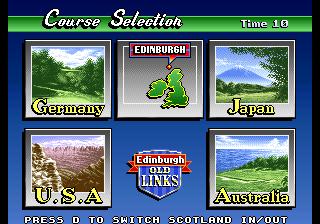
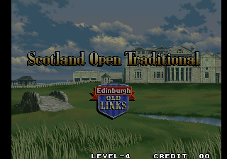
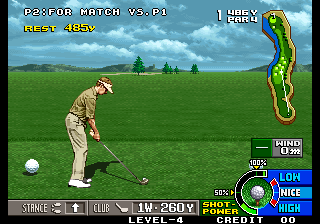
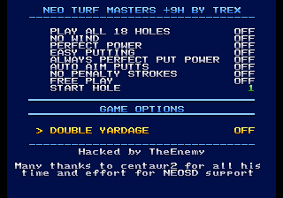
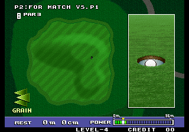

# NeoTurfMastersPlus+9H[TREX]

Neo Turf Masters (Neo Geo MVS/AES) with **Scotland added as a 5th course**, all four original courses kept, plus a **9-cheat trainer**.

**Download:** [v1.0 release](https://github.com/theenemy-thd/NeoTurfMastersPlus/releases/tag/v1.0). Patches only, no ROMs.

- `NeoTurfMastersPlus+9H.TREX._neo_patch.zip`: BPS patch for the .neo file (NeoSD, MiSTer, Geolith).
- `NeoTurfMastersPlus+9H.TREX._MAME_patch.zip`: BPS patches for the MAME `turfmast` ROM set (makes the `turfsco` set), plus a MAME software list entry.

Each zip has a README with the base hashes and steps.

## Features

- **Scotland (Edinburgh Old Links)** from the Neo Geo CD version as a 5th course, with its graphics, hole maps and announcer voice. Germany, Japan, USA and Australia are all kept. Press D on course select to switch Scotland in or out.
- **Title voice per region:** Japan says "Big Tournament Golf", USA and Europe say "Neo Turf Masters".
- **High scores:** MVS saves to backup RAM as normal. AES now saves high scores and course records to the memory card and loads them at power-on.
- **Double Yardage** game option from the CD version. It isn't a cheat, so scores still save, in their own tables.
- **Trainer menu** with 9 cheats: play all 18 holes, no wind, perfect power, easy putting (no green break), always perfect putt power, auto aim putts, no penalty strokes (OB and water), free play, start hole (A = next, B = previous; skipped holes count as par). High scores are not saved while any cheat is on.

**Compatible and tested on NeoSD.** Also runs on MiSTer, Geolith and MAME.

## Screenshots

## Credits

Hacked by TheEnemy. Many thanks to centaur2 for all his time and effort for NeoSD support.

Tested by ThePaw and centaur2.
